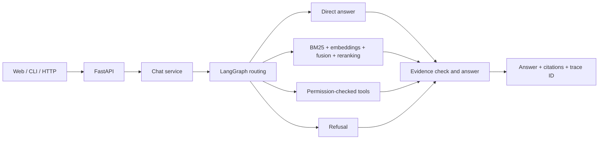

# Agentic Support

An English-language e-commerce support assistant built with FastAPI, LangGraph, hybrid search, and a React chat workspace. Customers can ask about store policies, look up demo orders, and request supported actions with explicit confirmation.

This repository contains an adapted and extended project. The current English policy corpus and evaluation set are demonstration material. Model quality, real payment, carrier integrations, and production authentication have not been verified.

## What it does

- Routes greetings, policy questions, multi-condition questions, account-specific requests, and out-of-scope requests to separate paths.
- Combines BM25 lexical retrieval with dense embeddings and reciprocal-rank fusion; optional cross-encoder reranking is available.
- Grounds policy answers in retrieved passages and attaches source citations.
- Uses tools for demo orders, shipment status, product data, returns, refunds, and cancellations.
- Requires customer confirmation before write or destructive actions.
- Provides a streaming chat UI, local conversation history, API health and capability endpoints, and Docker configurations.

## Run locally

Requirements: Python 3.11+, Node.js supported by the frontend, and Docker for the container setup.

```bash
python -m venv .venv
source .venv/bin/activate
pip install -e ".[dev]"
cp .env.example .env
uvicorn app.asgi:app --reload --port 8002
```

The API starts in offline demonstration mode when no model credentials are configured. Offline mode returns source excerpts or verified demo data instead of pretending to generate a full model answer. Configure a supported OpenAI-compatible generation endpoint and English-capable embeddings before evaluating model quality. See [configuration](docs/07-configuration.md).

In another terminal, start the web app:

```bash
cd frontend
npm ci
npm run dev
```

Open `http://127.0.0.1:5173`. The development server proxies API requests to the local FastAPI service.

## Example

```bash
curl -s http://127.0.0.1:8002/api/v1/chat \
  -H 'content-type: application/json' \
  -d '{"message":"Can I return a custom mug that arrived damaged?","user_id":"u_demo"}'
```

Seed sample orders with `python -m app.cli --help` for CLI usage and `scripts/seed_demo.py` for the demo seeding entry point. `ORD10001` is shipped, `ORD10002` is delivered, and `ORD10003` is paid but not shipped. Mutating requests return a pending action; confirm it explicitly before execution.

## Architecture



See [architecture](docs/03-architecture.md), [retrieval](docs/15-ingest-and-retrieval.md), and [tool safety](docs/05-agents-and-tools.md).

## Evaluation

Inherited Chinese benchmark results are not results for this English adaptation and are not claimed here. The English end-to-end set is a starter regression set, not a measured quality report. See [evaluation status and method](eval/MEASURED.md) and [evaluation guide](docs/10-evaluation.md).

Run checks with `pytest -q` and `cd frontend && npm test && npm run build`.

## Security and deployment limits

The demo API accepts a caller-provided `user_id`, stores local browser history in `localStorage`, and uses local demonstration orders. Do not expose it to untrusted users until authentication is verified and every conversation and order lookup is bound to the authenticated owner. Do not put credentials in source control. Review [security](docs/09-security.md) and [deployment](docs/11-deployment.md).

## Project structure

- `app/`: API, graph nodes, providers, retrieval, tools, and persistence
- `knowledge/`: fictional English store policies
- `frontend/`: React and TypeScript chat interface
- `eval/`: evaluation runner and English starter datasets
- `tests/`: unit, integration, and API tests
- `docs/`: focused English implementation guides

The design uses Adaptive-RAG as a published retrieval approach; the name describes the technique, not the project.
