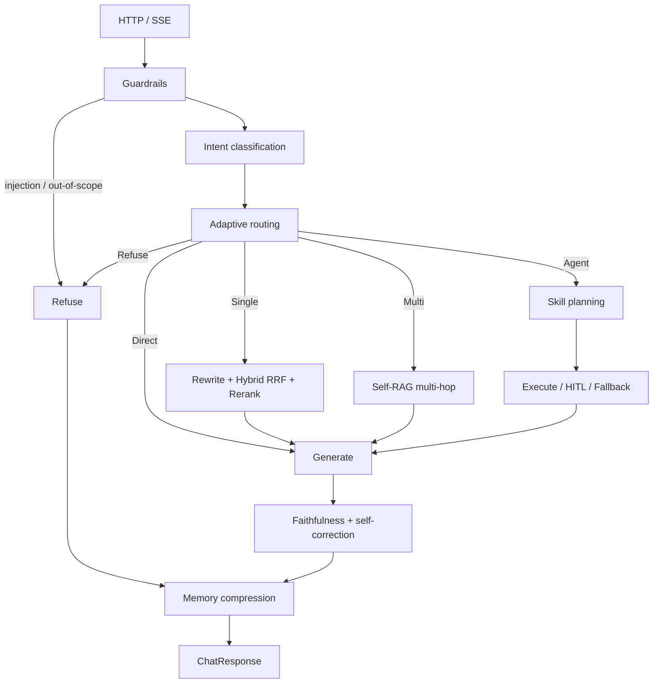

# Interviewer: Is this RAG a demo, or can it ship?

> Historical interview notes: the figures below describe the earlier Chinese-corpus version measured on 2026-08-22 with DeepSeek `deepseek-chat` and a Cross-Encoder. They are not results for the current English adaptation; see `eval/MEASURED.md` for current status. To map zero2Agent evaluation dimensions onto project modules and code, use [16 · Project Interview Map](16-interview-bagu-map.md).

## What one interview taught me

"'So tell me,' the interviewer opens. 'Your resume says you built an Adaptive-RAG multi-agent support bot. First question: do you run vector retrieval on every single query?'"

That was the first probe I got. Many people reflexively answer "yes — embed, then top-k." That is exactly the answer the interviewer wants you to **reject**.

E-commerce after-sales is not "encyclopedia Q&A." Users say "hi", ask for a human agent, ask whether `ORD10001` shipped, or request a refund. If greetings also hit the vector store, you waste more than money — you add latency and open up room for hallucination.

The follow-ups are almost a fixed set:

- Can vector and BM25 scores be added directly?
- What do you do about noise in recall?
- When the model says "refunded for the user," did the refund actually happen?
- Will timeout retries refund twice?
- How do you prove it's not a demo? Where is the eval set? What are P50/P95?

If the project is just `similarity_search` plus prompt concatenation, those questions will gut it. Below, the gap is laid out as "toy vs. this repo" — the code is literally in the repo, not a Pipeline framework invented for an article.

---

## What is toy RAG?

Toy RAG looks roughly like this:

```python
class ToyRAG:
    def ask(self, question: str) -> str:
        docs = self.vectorstore.similarity_search(question)
        context = "\n".join(d.page_content for d in docs)
        return self.llm.chat(f"Answer based on the materials:\n{context}\n\nQuestion: {question}")
```

It runs. But it assumes five things that don't hold in a support scenario:

1. **Every question should trigger retrieval** (greetings, injections, order lookups should not take the same path)
2. **One vector pass is enough** (policy clauses are full of "7 days", "ORD", "SKU" — keyword retrieval is often more robust)
3. **Everything recalled is evidence** (without a faithfulness check, the model will turn "maybe" into "already refunded")
4. **LLM output can execute side effects directly** (refunds and cancellations with no confirmation)
5. **No numbers** (no Hit@1, hallucination rate, P95 — all optimization is vibes)

That's the difference between "a demo that runs" and "a project you can defend for 30 minutes."

---

## What does engineering-grade RAG look like in this project?

Compared with the usual "pipeline article," we did not build another `PipelineStage` base class — we used **LangGraph conditional edges** to turn stages into testable nodes. The stages are still there; only the orchestration differs.

| Stage | Toy | This repo |
|---|---|---|
| Whether to retrieve | Always retrieve | Adaptive: Direct / Single / Multi / Agent / Refuse |
| Query understanding | Search the raw sentence | Guardrails → intent → complexity routing → rewrite |
| Recall | Single vector path | BM25 + vector, rank fused with RRF; either path may fail |
| Rerank | None | Local Cross-Encoder (bge-reranker-base; when weights aren't loaded, CI degrades to lexical overlap and does not impersonate CE) |
| Multi-hop | None | Self-RAG: retrieve → JSON grading → hop again on `missing_aspect` |
| Tools | None | 15 schema-validated tools; writes are HITL + idempotent |
| Generation validation | None | Faithfulness check → LLM self-correction → extractive fallback |
| Long sessions | Append history forever | 128k budget with three-tier compression at 50% / 70% / 85% |
| Evaluation | None | 100 intent / 65 retrieval / 65 generation / 16 E2E |

The request path can be drawn as one line:

```text
HTTP → ChatService (rate limiting, Session, UoW)
     → LangGraph
        guardrails → intent → complexity
          ├ Direct  generate
          ├ Refuse  refuse
          ├ Single  rewrite → Hybrid → Rerank → generate
          ├ Multi   Self-RAG multi-hop → generate
          └ Agent   Skill narrowing → plan → execute (read-failure fallback to another tool) → generate
        → faithfulness → memory compression
```

Node names deliberately don't share names with state fields (`classify_intent`, not `intent`), otherwise LangGraph mangles the updates. The graph is compiled once at process startup; the SQLAlchemy session is **created per request**, passed to tools via contextvars, and baking a connection into the graph is forbidden.

### 1.3 The full engineering framework (the one to draw on the interview whiteboard)

Compared with the "query rewrite → multi-path recall → rerank → generate" pipeline, support adds **Adaptive five-way routing** and **tool HITL**. Five layers, top to bottom:

```text
┌─────────────────────────────────────────────────────────────────┐
│  Access      FastAPI · SSE · rate limiting · trace_id · UoW    │
│           app/api  →  ChatService                               │
└─────────────────────────────────────────────────────────────────┘
                              │
                              ▼
┌─────────────────────────────────────────────────────────────────┐
│  Orchestration   LangGraph (compiled once at process start)     │
│                                                                 │
│   Guardrails ──► Intent ──► Adaptive routing                    │
│                         │                                       │
│            ┌────────────┼────────────┬──────────┐               │
│            ▼            ▼            ▼          ▼               │
│         Direct       Refuse       Single      Multi     Agent   │
│      generate now     refuse    Hybrid recall Self-RAG  plan+tools│
│            │            │            │          │          │    │
│            └────────────┴────────────┴──────────┴──────────┘    │
│                              │                                  │
│                              ▼                                  │
│                  Generate ──► Faithfulness/self-fix ──► Compress│
└─────────────────────────────────────────────────────────────────┘
          │                              │
          ▼                              ▼
┌──────────────────────┐    ┌─────────────────────────────────────┐
│ Retrieval subsystem  │    │ Tool subsystem                      │
│ rewrite · BM25 · vector│   │ 15 business tools · Skill loading   │
│ RRF(k=60) · Cross-Encoder │ │ MCP Function Calling                │
│ Self-RAG ≤3 hops     │    │ HITL + idempotency · read fallback  │
│ app/retrieval/       │    │ app/tools · skills · mcp            │
└──────────────────────┘    └─────────────────────────────────────┘
                              │
                              ▼
┌─────────────────────────────────────────────────────────────────┐
│  Infra:  DeepSeek · Cross-Encoder · Postgres/SQLite · Redis · Qdrant │
│          Provider isolation; fake / hash / in-memory when keys are missing │
└─────────────────────────────────────────────────────────────────┘
```

The corresponding Graph conditional edges (paste-ready for an article):



Pipeline stages mapped against that original table:

| Stage in the original piece | Where it lives in this repo | What it does |
|---|---|---|
| Intent classification | `classify_intent` + overlay | 14 classes; handoff beats refund |
| Query rewrite | `QueryRewriter` | Single / each Self-RAG hop |
| Multi-path recall | BM25 + vector, either path may fail | BM25 still usable with no real embedding |
| Result fusion | RRF `k=60` | Fuses ranks, not scores |
| Reranking | Local Cross-Encoder | Never impersonates CE when weights aren't loaded |
| Prompt / generation | `generate_node` JSON | citation_chunk_ids |
| Result validation | `check_faithfulness` | LLM rewrite → extractive fallback |
| (not in the original) | Agent + HITL | Orders/refunds can't rely on retrieval alone |
| (not in the original) | `compact_memory` | 128k budget, three-tier compression |

---

## 1. Architecture: not a single function, but a bounded state machine

### Why split into nodes?

The problem with a single `ask()`: retrieval failure, tool failure, hallucination, and refusal all blur together, SSE can't push progress, and unit tests can only exercise the whole blob. Split apart:

- Which node is slow is visible in Prometheus per-section latencies
- Write tools can halt at planning time and wait for user confirmation
- `MAX_AGENT_STEPS` / `MAX_TOOL_CALLS` have hard caps

### Code: route edges by strategy

```python
# app/agents/graph.py
def _route_after_complexity(state: AgentState) -> str:
    strategy = state.get("strategy") or RetrievalStrategy.SINGLE
    return {
        RetrievalStrategy.DIRECT: "generate_answer",
        RetrievalStrategy.REFUSE: "refuse_answer",
        RetrievalStrategy.SINGLE: "retrieve_docs",
        RetrievalStrategy.MULTI: "retrieve_docs",  # Self-RAG happens inside the node
        RetrievalStrategy.AGENT: "plan_tasks",
    }[strategy]
```

`SINGLE` and `MULTI` share `retrieve_docs` and branch on `state.strategy`, avoiding a duplicated edge set.

### Code: the Graph is compiled once, the DB is created fresh every time

```python
# app/core/request_scope.py
_db_session: ContextVar[AsyncSession | None] = ContextVar("db_session", default=None)

def get_db_session() -> AsyncSession:
    session = _db_session.get()
    if session is None:
        raise RuntimeError("no request-scoped database session")
    return session
```

A good interview aside: tools run inside node closures, and closures are process-level; if you store an `AsyncSession` inside the compiled graph, connections leak across requests.

---

## 2. Retrieval: it's not "embed, then top-k"

### 2.1 Route first, then decide whether to retrieve

The Adaptive-RAG paper has three tiers (no retrieval / single-hop / multi-hop); e-commerce adds two: **Agent** (order tools) and **Refuse** (out of scope).

If the LLM classifier fails, the system must still run. The rules look at intent, order numbers, and multi-hop cues like "also / after / but":

```python
# app/retrieval/adaptive.py (rule fallback, abbreviated)
if intent.label == IntentLabel.OUT_OF_SCOPE:
    return ComplexityResult(strategy=RetrievalStrategy.REFUSE, ...)
if intent.label in {IntentLabel.GREETING, IntentLabel.CHITCHAT}:
    return ComplexityResult(strategy=RetrievalStrategy.DIRECT, ...)
if intent.label in {ORDER_INQUIRY, LOGISTICS, REFUND, ...} or has_order_number:
    return ComplexityResult(strategy=RetrievalStrategy.AGENT, ...)
```

**Say proactively:** when an order number is present, Agent beats Multi — check the system first, don't search policy first.

### 2.2 Why fuse ranks, not scores?

BM25 and cosine are not on the same scale. Write `0.5 * bm25 + 0.5 * cosine` and it breaks the moment you swap the embedding weights. RRF only looks at ranks:

```python
# app/retrieval/fusion.py
# RRF(d) = Σ 1 / (k + rank_i(d)); k=60 is Cormack's default, not a tuned-by-this-project value
scores[chunk.chunk_id] = scores.get(chunk.chunk_id, 0.0) + 1.0 / (k + rank_position)
```

### 2.3 One path failing must not drag down the other

```python
# app/retrieval/hybrid.py
try:
    lexical = self._bm25.search(query, top_k=top_k)
except Exception:
    lexical = []
try:
    dense = await self._vector.search(query, top_k=top_k)
except Exception:
    dense = []
if not lexical and not dense:
    raise RetrievalError("both lexical and dense retrievers failed")
fused = reciprocal_rank_fusion([lexical, dense], k=self._rrf_k)
```

**You must say proactively:** the historical dense path was `bge-small-zh-v1.5` (not m3). Vector-only P@1 **83.1%**, R@3 **94.6%**. BM25 baseline 76.9% / 90% / 0.84. On these 65 cases RRF matches small-only; the Cross-Encoder lifts P@1 / R@3 to **89.2% / 97.7%**. The same-day hash baseline only reached Hit@1 3.1%.

### 2.4 Self-RAG is not special tokens

Multi-constraint questions (made-to-order + past 7 days + quality) often hit only the general policy in one hop. After each hop, grade with JSON: stop when `sufficient` is true, otherwise rewrite using `missing_aspect` and hop again, capped at `MAX_RETRIEVAL_HOPS=3`.

```python
# app/retrieval/self_rag.py
class GradeResult(BaseModel):
    relevant: bool
    sufficient: bool
    missing_aspect: str = ""
```

Structured output is what makes grading unit-testable and degradable on failure — instead of parsing a pile of special symbols.

### 2.5 Chunking: stable IDs beat "adaptive cleverness"

Toy projects use uuid4 as the chunk id, and every re-ingest breaks all references. Here:

```python
# app/retrieval/chunking.py
MAX_CHUNK_CHARS, OVERLAP_CHARS = 500, 60

def stable_chunk_id(document_id: str, chunk_index: int) -> str:
    return f"{document_id}_{chunk_index:02d}"
```

Production chunks with Unstructured by element (Title/Table, etc.), then maps to stable `chunk_id`. With missing dependencies or under pytest it degrades to Markdown heading chunking. The Qdrant point id derives from chunk_id, so re-ingest overwrites the same points. The knowledge base has 39 Markdown docs.

---

## 3. Agents: retrieval can't solve "refund this order"

Policy Q&A can be RAG; "cancel ORD10003" must hit the order database, and the model must not write to the DB directly.

### 3.1 Intent: LLM + overlay

Production path: DeepSeek emits JSON (`intent_v3`) → a high-confidence overlay corrects it (handoff beats refund/complaint; "how does it work" goes to policy, "can this item be returned" goes to returns/exchange). If the LLM is down, keyword rules take over, then the same overlay.

100-case offline set: rules 51% → no-overlay v1/v2 ~85%/86% → **v3+overlay 100%**.

**Say proactively:** accuracy includes the overlay; the overlay targets stable Chinese support phrases, it is not gold labels hardcoded per `i070`. The eval supports `apply_overlay=False` for ablation.

### 3.2 On-demand Skill loading

Shoving all 15 tools into the Planner makes the model mis-call `cancel_order`. After a returns/logistics/recommendation Skill hits, the catalog shrinks to that Skill's tools + `search_knowledge` + `escalate_to_human`. This is the planning-layer fallback: if LLM planning fails, the Skill JSON is flattened into steps.

### 3.3 HITL + idempotency

```python
# app/tools/permissions.py
WRITE_RISKS = {ToolRisk.WRITE, ToolRisk.DESTRUCTIVE}

def assert_permitted(tool, *, confirmed: bool) -> None:
    if tool.risk in WRITE_RISKS and not confirmed:
        raise ToolPermissionError(...)
```

Planning generates a `pending_action`; execution happens only when the client sends `confirm_action_id`. The same idempotency key + parameter fingerprint returns the first result; a different fingerprint returns `IDEMPOTENCY_CONFLICT`.

If the interviewer asks "will timeout retries refund twice?": answer with idempotency keys, not "we rarely retry."

### 3.4 Execution-layer fallback

Only read-tool failures swap tools, e.g. `get_order` → `search_knowledge`. **Permission denials and write operations never go through this table**, so an unconfirmed refund can't sneak out via "try a different tool."

### 3.5 Faithfulness self-correction

After generation, the judge grades `supported`. On failure, the LLM first rewrites once against the evidence, then extractive fallback. 65 cases (same-model judge, optimistic):

| | Faithfulness | Hallucination rate | Keyword hits |
|---|---|---|---|
| No retrieval | 76.9% | 23.1% | 35.4% |
| RAG | 98.5% | 1.5% | 84.6% |
| RAG + self-correction | 100% | 0% | 84.6% |

No-retrieval faithfulness falls in the 54%–88% band; relative hallucination reduction 100%. Keyword hits are more independent than same-model faithfulness — put both side by side in interviews.

---

## 4. Evaluation: no offline set, no resume numbers

Full report: [14 · Evaluation Report](14-evaluation-report.md).

The fatal flaw of toy projects is "I feel like it works decently." This repo pins numbers to the runner:

```bash
python -m eval.runner --task retrieval          # CI, works offline
python -m eval.runner --task intent --llm
python -m eval.runner --task generation --llm
python -m eval.runner --task e2e --llm
```

Document-level P@k / R@k: strip the suffix off the chunk's `document_id` to get the stem, then compare with `relevant_doc_ids`.

```python
# eval/metrics.py
def precision_at_k(relevant, retrieved, k):
    top = retrieved[:k]
    return sum(item in relevant for item in top) / len(top)
```

E2E 16 cases (including injection): refusal/tool paths 100%; keywords **9/11**; P50 **4.9s** / P95 **5.8s**. Injection refusal takes about 10ms — because it never touches the LLM.

pytest clears real keys and doesn't download local models (`tests/conftest.py`), 154 passed. Live numbers require `--llm`.

**You cannot write:** "CE lifted Precision to xx" without the Cross-Encoder loaded; "hallucination dropped 62%" without running generation.

---

## 5. Engineering: timeouts, retries, observability, security

| Dimension | Toy | This repo |
|---|---|---|
| Timeouts | Default infinite read | connect 3s / read 30s / write 10s / pool 5s |
| Retries | None, or retry on any error | full jitter; no retry on 401/403/422 |
| Rate limiting | None | per `user_id`; Redis down → fail-open |
| Auth | None | admin requires a token in production; compared with `hmac.compare_digest` |
| Injection | None | regex intercept + retrieved content treated as untrusted data |
| Logs | print | JSON + `trace_id`; secrets as `SecretStr` |
| Metrics | None | `/metrics`: strategy, per-section latencies, tool fallbacks, hallucination count |
| Streaming | None | SSE: `node` + DeepSeek `token` |
| Config | Hardcoded | pydantic-settings; Fake LLM / hash vectors / in-memory DB degradation |

```python
# app/core/retry.py
RETRYABLE = {408, 429, 500, 502, 503, 504}

def _full_jitter_delay(attempt, base, cap):
    ceiling = min(cap, base * (2 ** attempt))
    return random.uniform(0.0, ceiling)
```

If 401s were retried, one bad key would multiply into a string of invalid billed calls. Exponential backoff without jitter wakes every replica at the same moment.

Business-level "insufficient evidence" is **HTTP 200 + copy**; only a DeepSeek timeout is **503 `LLM_TIMEOUT`**. Don't conflate the two.

---

## How to answer in the interview (matched to this piece)

What the interviewer really wants to hear isn't framework names — it's whether you designed the failure paths.

**Q: Why doesn't every query go through vector retrieval?**
A: Adaptive routing. Greeting → Direct; out-of-scope → Refuse; policy → Single/Multi; orders → Agent. The paper's three tiers aren't enough for e-commerce.

**Q: How does Hybrid fuse?**
A: RRF fuses ranks; k=60 is the literature default. BM25 and cosine have different scales. This round, `bge-small`-only P@1 was 83.1%; RRF matched small-only; externally report Hybrid+CE 89.2% / 97.7% / 0.94. Hash baseline Hit@1 was 3.1%.

**Q: How do you suppress hallucinations?**
A: A post-generation faithfulness check; on failure the LLM rewrites against the evidence first, then extractive fallback. On 65 cases: no-retrieval hallucination 20% → RAG 3.1% → self-correction 0%. The same-model judge is optimistic, so keyword hits are reported alongside: 36.9% → 95.4%.

**Q: Can a refund misfire? Can it refund twice?**
A: write/destructive requires `confirm_action_id`. Idempotency key + parameter fingerprint. Only read failures trigger fallback; write failures never switch to another write tool.

**Q: How do you prove it's not a demo?**
A: Offline set + `eval.runner` + pytest. Resume numbers defer to MEASURED. P50 4.9s / P95 5.8s. Intent: 100 cases at 100% including the overlay. Hybrid+CE P@1 89.2%.

**Q: What's still missing?**
A: No CE numbers unless the Cross-Encoder is loaded; the dense path is small, not m3; RRF didn't beat small-only on this set; orders are seed data, not carrier APIs; the token budget is a heuristic, not the official tokenizer.

If all you can say is "I hooked LangChain up to a vector store," it's still a toy. If you can connect the sections above, and the numbers match the repo, that's what "engineering-grade, deployable" means in this project.

---

## Closing thought

The difference between a demo and a product isn't one more framework layer. It's:

- Knowing **when not to retrieve**
- Knowing **two paths' scores can't be added**
- Knowing **the model wants to refund ≠ the user agreed to refund**
- Having an **eval set you must rerun whenever the prompt changes**

The repo's handbook is written in `docs/` as "key points → code summary → why." This piece is the interview script for the same implementation; for numbers, [`eval/MEASURED.md`](../eval/MEASURED.md) is authoritative.
