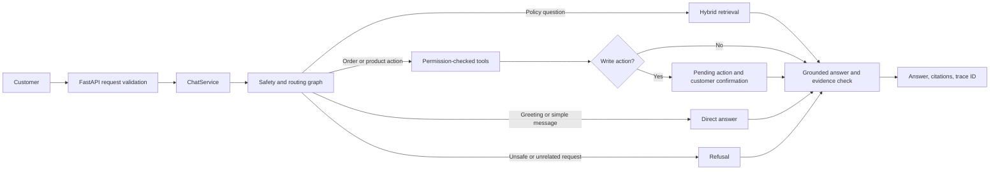

# Request Flow

The API accepts a support message, assigns request and trace IDs, and sends the request through the LangGraph workflow. The graph selects a direct answer, retrieval, tools, or refusal. Write actions pause for customer confirmation. The final response includes citations when retrieved evidence supports them.

The graph is implemented in `app/agents/graph.py`; API and lifecycle wiring are in `app/main.py` and `app/services/container.py`. For retrieval details, see [04 · Adaptive Retrieval](04-adaptive-rag.md). For tool permissions and confirmation, see [05 · Agents and Tools](05-agents-and-tools.md).
